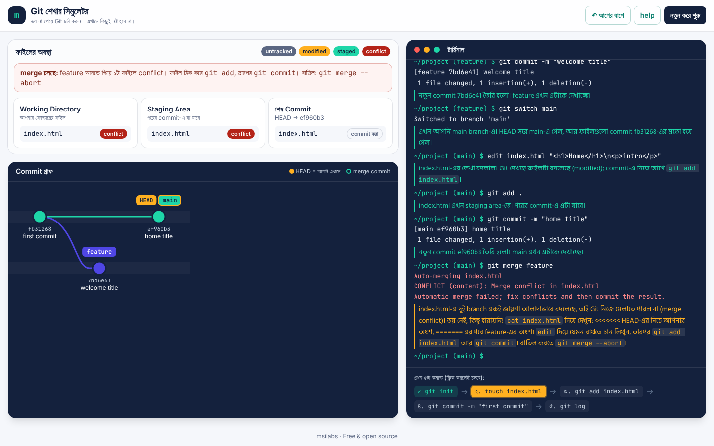

# Git Learning Simulator

[](https://github.com/msilabs/git-simulator/actions/workflows/pages.yml) [](LICENSE)

A browser-based playground for learning Git without fear. Type Git commands into a fake terminal, watch the commit graph and file states update instantly, and read a short explanation in Bengali after every command.

**Live:** https://msilabs.github.io/git-simulator/

No real Git runs here. A small, pure TypeScript model of Git lives in `src/lib/git/`. There is no server, database or login, and your progress is saved in your browser's `localStorage`.



## Supported commands

| Command | What it does |
|---|---|
| `git init` | Create a repository (re-running it prints "Reinitialized...") |
| `git status` | Show the branch plus staged, modified and untracked files |
| `git add <file>...` / `git add .` | Stage files |
| `git commit -m "message"` | Create a commit from the staging area |
| `git commit --amend [-m "message"]` | Replace the last commit with a new one (same parent, new snapshot or message) |
| `git commit -a -m "message"` / `-am` | Stage every modified or deleted tracked file, then commit (untracked files are left out) |
| `git log` / `git log --oneline` | Show history reachable from the current branch |
| `git log --oneline --graph [--all]` / `-n <N>` | Draw branches and merges as an ASCII graph like real Git / show only the newest N commits |
| `git show [<commit>]` | Show a commit and the diff it introduced |
| `git branch` / `git branch <name>` | List branches / create a branch at the current commit |
| `git switch <name>` / `git switch -c <name>` | Switch branches / create and switch |
| `git checkout <name>` / `git checkout -b <name>` | Same as above, using the older command |
| `git merge <branch>` | Fast-forward, a two-parent merge commit, or stop on a merge conflict |
| `git merge --abort` / `--continue` | Cancel a conflicted merge / finish it (same as `git commit`) |
| `git diff` / `git diff --staged` | Unified diff of unstaged / staged changes (`--cached` also works) |
| `git restore <file>` / `git restore --staged <file>` | Discard working-tree changes / unstage (`.` for everything) |
| `git branch -d` / `-D <name>` | Delete a merged branch / force-delete |
| `git branch -m` / `-M [<old>] <new>` | Rename a branch |
| `git reset [--soft \| --mixed \| --hard] [<commit>]` | Move the branch back: `--soft` keeps changes staged, `--mixed` (default) keeps them unstaged, `--hard` discards them |
| `git reset <file>` | Unstage a file (like `git restore --staged`) |
| `git revert <commit>` | Add a new commit that undoes an earlier one; `--continue`, `--abort`, `--skip` after a conflict |
| `git stash` / `git stash -m "msg"` | Put uncommitted changes to tracked files aside and clean the folder |
| `git stash list` / `pop` / `apply` / `drop` / `clear` | List, bring back, or delete stashed changes (`stash@{n}` picks an entry) |
| `git clone <url>` | Get a copy of a remote repository (always a small demo project) |
| `git remote [-v]` / `git remote add <name> <url>` / `remove` | Show, add or remove the remote |
| `git push [-u] [--force] [<remote> [<branch>]]` | Send your commits to the remote; `-u` sets the upstream |
| `git fetch [<remote>]` | Download what is new on the remote into `origin/...` without touching your branch |
| `git pull [--no-rebase \| --ff-only] [<remote> [<branch>]]` | `fetch` + `merge`. Like Git 2.56, divergent branches need `git config pull.rebase false` or `--no-rebase` first |
| `git branch -r` / `-a` / `--set-upstream-to=<remote>/<branch>` | List remote-tracking branches / set a branch's upstream |
| `git config [--global] user.name\|user.email\|pull.rebase\|pull.ff [<value>]` | Settings; `user.name`/`user.email` become the author of new commits |
| `git rm <file>` / `git rm --cached <file>` | Delete a tracked file and stage the deletion / stop tracking it but keep the file (`-f` to force, `-r .` for everything) |

Simulator-only helpers: `teammate [-b <branch>] <file> "text"` (an imaginary colleague pushes a commit to the remote, so you can practise fetch, pull and rejected pushes), `touch <file>`, `edit <file> "text"` (use `\n` for new lines), `echo "text" > <file>` / `>> <file>` (overwrite / append a line), `rm <file>`, `ls`, `cat <file>`, `pwd`, `help`, `clear`.

In the file panel, tap a working-directory file to see it, then **Edit** to change it in place. Saving runs the matching `edit <file> "..."` command in the terminal, so undo and reloads keep working and you can see the command it stands for. This makes resolving merge conflicts much easier.

**Tab** completes command, file, branch and stash names like a real shell: one match is filled in, several matches fill in their common part, and a second Tab lists them. On an empty line, Tab moves focus as usual.

## Missions

Below the terminal, a learning path of 11 missions guides you: first commit, diff and a second commit, branches, merge and the graph, a merge conflict, undoing file changes, revert and reset, stash, pushing to a remote, pulling a teammate's work, and a rejected push. Each mission has 2-5 stages that complete by result, not by exact text (so `git add .` counts as well as `git add index.html`). Progress is saved and undo steps back through it. All mission text lives in `src/lib/missions.ts`.

The page follows your system's light or dark theme; the **☾ / ☀** button in the top bar switches it and remembers your choice.

The **↶ undo** button in the top bar steps back one command at a time. Real Git has no such button; the explanation says so.

### Merge conflicts

Merges are line-based (diff3). If the two branches changed different lines, Git merges them automatically. If they changed the same lines, the merge stops, writes Git-style conflict markers into the file, and `git status` lists "Unmerged paths". You resolve it the real way: `edit` the file, then `git add` it, then `git commit`. `git restore --staged <file>` settles a conflicted file with our version. Modify/delete and add/add conflicts are supported too. To resolve a conflict by deleting the file, use `git rm <file>`.

Other Git commands are recognised as "not in the simulator yet".

### Where the model is simpler than real Git

- Commit ids are 7-character hex ids from a small hash, not SHA-1. They are unique within a session.
- There are no folders. File names are flat, and there are no globs.
- `__proto__` cannot be used as a file or branch name (a JavaScript object cannot hold that key). Every other name, including `constructor` or `toString`, works normally.
- The line-level merge is plain diff3 with the default `merge` conflict style. Real Git (ort) has extra heuristics, so in rare cases it draws conflict hunks differently.
- While a merge is in progress, both `switch` and `checkout` refuse to change branches. Real `checkout` allows it once every conflict is resolved.
- `git diff` during a conflict shows a normal diff against our version, not Git's combined `diff --cc` format. Commit-to-commit diffs (`git diff main feature`) are not supported yet.
- The `index` line in `git diff` uses short fake blob ids (an empty file still gets the real `e69de29`).
- Commits that no branch can reach (after `git branch -D`) disappear from the graph and log, as in real Git. The simulator also never garbage-collects them.
- The merge base is the newest common ancestor. Real Git also handles multiple merge bases.
- `git log` shows no `Date` line, uses a fixed author and does not open a pager. `--graph` works only together with `--oneline`, and lines that jump more than one column are drawn in one step. `git show` on a merge commit shows only the header.
- `git commit` without `-m` asks for a message instead of opening an editor.
- Line counts in `insertions(+)/deletions(-)` ignore whether a file ends with a newline.
- There is no detached HEAD, and `git checkout <file>` is not supported.
- Revisions understand `HEAD`, branch names, commit ids (or a unique prefix of 4+ characters), `~n`, `^` and `^2`. There is no reflog, but commits left behind by `reset` or `--amend` can still be reached by id.
- `git commit --amend` and `git revert` print no `Date` line. `git revert` takes one commit at a time and cannot revert merge commits (`-m` is not supported).
- There is no network. A remote lives inside the simulator, there is only one, and `git clone` always brings the same demo project into the current folder (real Git creates a new folder). Pushes take no `<src>:<dst>` refspecs, tags or `--delete`, and there is no rebase (`git pull --rebase` is not supported).
- Advice lines such as `hint: Disable this message with "git config set advice..."` are left out, and `git config --list` shows only the settings the simulator knows.
- `git stash` keeps entries in a separate list, not as commits, so they do not appear in the graph. Untracked files are never stashed (`-u` is not supported). A conflicting `stash pop`/`apply` writes "Updated upstream" / "Stashed changes" markers like real Git and keeps the entry.

Like real Git, `switch`/`checkout` carry uncommitted changes along when the file is identical on both branches. They refuse only when your changes would be overwritten.

## Run locally

Requires Node.js 20 or newer.

```bash
npm install
npm run dev      # http://localhost:3000
npm test         # Vitest unit tests (Git model, session, storage)
npm run build    # static export into out/
npm start        # preview the built site from out/ (tiny Node server in scripts/serve.mjs)
npm run test:e2e # Playwright browser tests against out/ (run the build first)
```

Every pull request runs lint, type-check, unit tests, the build and the browser tests in CI (`.github/workflows/ci.yml`).

The site is a fully static export (`output: "export"`). Every push to `main` runs the tests and deploys to GitHub Pages through `.github/workflows/pages.yml`, which builds with `BASE_PATH=/git-simulator`. Vercel also works without any changes.

## Project layout

```
src/lib/git/
  types.ts        Repo, Commit, SimState, CommandResult types
  repo.ts         runCommand(state, input) => { state, output, explanation, ok }
  parser.ts       splits terminal input into words (handles quotes)
  messages.ts     every Bengali command explanation and error in one place
  merge3.ts       line-level three-way merge with conflict markers
  diffFormat.ts   unified diff output for git diff
  lines.ts        line-based LCS diff
  tree.ts         file snapshots: comparing, stats, switching trees
  refs.ts         commits, branches, ancestry, ids, name checks
  own.ts          has()/get(): safe lookups by user-typed names
  helpers.ts      result helpers, re-exports the three modules above
  commands/       one file per command + index.ts registry
src/lib/session.ts  terminal session: run, undo, replay (pure)
src/lib/storage.ts  localStorage save/load with validation
src/lib/missions.ts the learning path: 11 missions and their stages
src/lib/ui-text.ts  every Bengali UI label in one place
src/lib/graph/    pure layout for the SVG commit graph
src/components/   Terminal, FilePanel, CommitGraph, Simulator
tests/            Vitest tests for every command
```

State is immutable: every command returns a new `SimState` (or the same object when nothing changed). Because the model is deterministic, the app saves only a base state plus the list of commands and replays them on load. The list is compacted after 200 commands, so saves stay small. After compaction you can still undo the last 100 commands.

## Adding a new command

1. Create `src/lib/git/commands/<name>.ts` and export a `CommandHandler`:
   `(state, args) => CommandResult`. Never mutate `state`; return a new object.
2. Put all Bengali text in `src/lib/git/messages.ts`.
3. Register it in `src/lib/git/commands/index.ts` (`GIT_COMMANDS` for `git <name>`, `SHELL_COMMANDS` for helpers) and add a line to `HELP_ENTRIES`.
4. Add `tests/<name>.test.ts`. When unsure, match real Git's behaviour and output. If you simplify, say so in a code comment.

See [CONTRIBUTING.md](CONTRIBUTING.md) for details.

## Community

- [Changelog](CHANGELOG.md)
- [Code of Conduct](CODE_OF_CONDUCT.md)
- [Security policy](SECURITY.md)
- Found a bug, a confusing Bengali explanation, or output that differs from real Git? [Open an issue](https://github.com/msilabs/git-simulator/issues/new/choose).

## বাংলায় সংক্ষেপে

**Git শেখার সিমুলেটর** হলো নতুন ডেভেলপারদের জন্য একটা ফ্রি, ওপেন-সোর্স অনুশীলনের জায়গা। ব্রাউজারের নকল টার্মিনালে Git কমান্ড লিখুন। পাশে commit গ্রাফ আর ফাইলের অবস্থা সাথে সাথে বদলাবে, আর প্রতিটা কমান্ডের পর বাংলায় ছোট ব্যাখ্যা আসবে: কী ঘটল আর কেন। এখানে আসল Git চলে না, তাই ভুল করলেও কিছু নষ্ট হবে না। ওপরের "নতুন করে শুরু" বোতাম চাপলেই আবার প্রথম থেকে শুরু করা যায়।

অনলাইনে চালান: https://msilabs.github.io/git-simulator/

শুরু করতে লিখুন `git init`, তারপর টার্মিনালের নিচের মিশনগুলো একে একে শেষ করুন: প্রথম commit থেকে শুরু করে branch, merge conflict, ভুল ফেরানো, stash আর remote পর্যন্ত মোট ১১টা মিশন।

## License

[MIT](LICENSE) © msilabs
